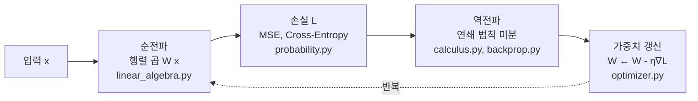
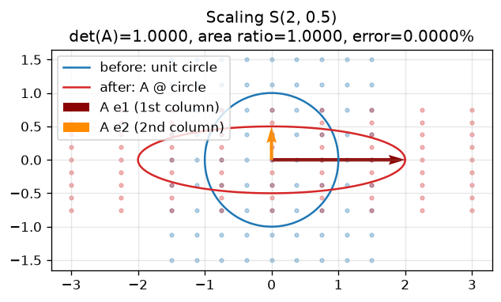
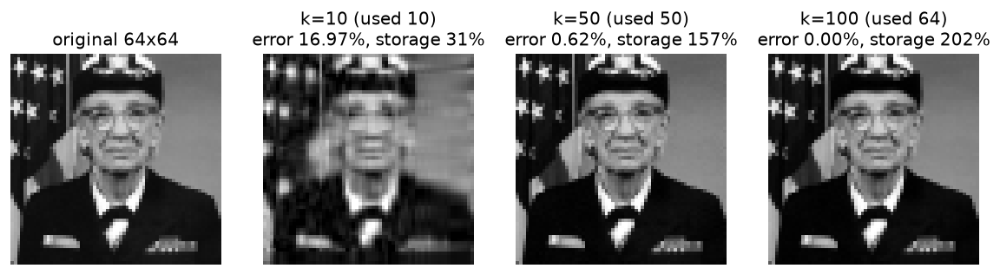
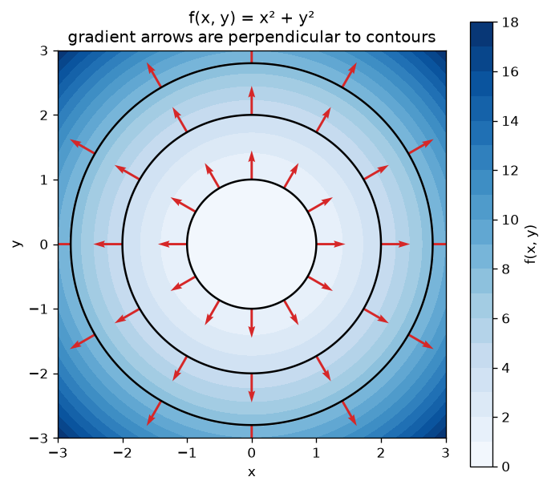
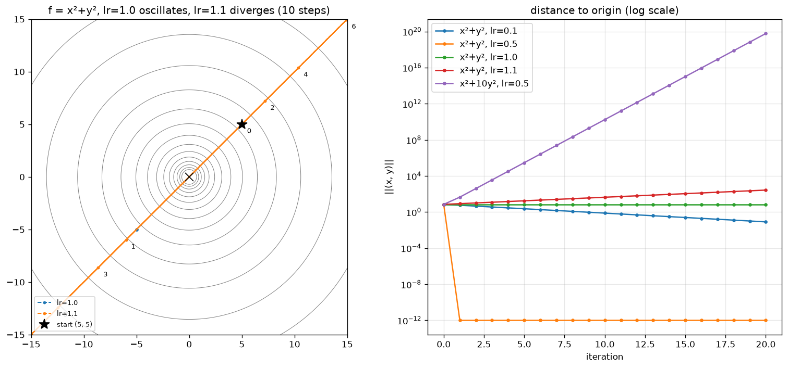
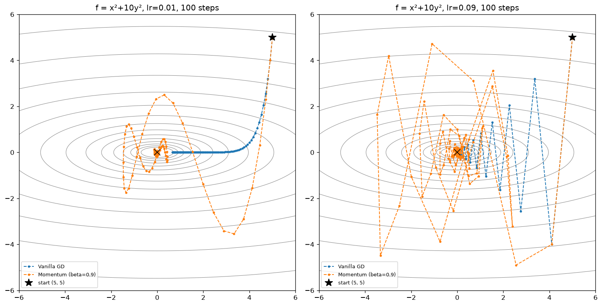

# Codyssey-A2-1-LinearAlgebra

### 이 과제는 AI가 데이터를 **변형**하고 스스로 **학습**하는 과정을 선형대수, 미적분, 확률로 직접 계산하고 그림으로 확인한다.
- `Python`으로 하는 AI 수학 과제이다.
    - 모든 수학 계산은 `NumPy`, 시각화는 `Matplotlib`과 `Seaborn`만 사용한다. 자동 미분 라이브러리는 쓰지 않는다.
- 신경망 학습 한 번을 이루는 네 가지 수학을 모듈과 노트북으로 하나씩 구현했다.
    - 선형대수: 행렬 변환과 행렬식, `Power Iteration`으로 고유값 구하기, `SVD` 이미지 압축
    - 미적분과 역전파: 중심차분 수치 미분, `Gradient` 시각화, 2층 신경망 역전파 손계산
    - 최적화와 확률: `Vanilla GD`, `Momentum` 경사하강법, 손실 함수와 최대우도추정(`MLE`)의 연결

# 목차

- [1. 과제 설명](#1-과제-설명)
    - [1.1 어떤 과제인가](#11-어떤-과제인가)
    - [1.2 사용 기술 스택](#12-사용-기술-스택)
    - [1.3 프로젝트 구조](#13-프로젝트-구조)
    - [1.4 실행 방법](#14-실행-방법)
- [2. 등장 개념](#2-등장-개념)
    - [2.1 신경망 학습과 AI 수학](#21-신경망-학습과-ai-수학)
    - [2.2 개념 분류표](#22-개념-분류표)
- [3. 구현](#3-구현)
    - [3.1 Data](#31-data)
    - [3.2 선형대수: 행렬 변환과 분해](#32-선형대수-행렬-변환과-분해)
    - [3.3 미적분: 수치 미분과 Gradient](#33-미적분-수치-미분과-gradient)
    - [3.4 역전파: 연쇄 법칙 손계산](#34-역전파-연쇄-법칙-손계산)
    - [3.5 최적화: 경사하강법](#35-최적화-경사하강법)
    - [3.6 확률/통계: 손실 함수와 MLE](#36-확률통계-손실-함수와-mle)
- [4. 최종 결과물](#4-최종-결과물)
    - [4.1 기능 요구사항 결과](#41-기능-요구사항-결과)
    - [4.2 보너스 과제 수행 결과](#42-보너스-과제-수행-결과)

<br>
<br>

# 1. 과제 설명

## 1.1 어떤 과제인가

신경망은 입력에 행렬을 곱해 공간을 변형하고(순전파), 틀린 정도(손실)를 미분해(역전파), 기울기 반대 방향으로 가중치를 조금씩 고친다(경사하강법). 라이브러리를 쓰면 한 줄이지만, 안에서 무슨 일이 일어나는지 모르면 학습이 안 될 때 원인을 찾을 수 없다. 이 과제는 그 과정을 수식으로 유도하고 `NumPy`로 직접 계산해 그림과 숫자로 확인한다.

개요에 나온 핵심 용어

| 용어 | 한 줄 설명 | 자세히 |
|---|---|---|
| `Power Iteration` | 행렬을 계속 곱하면 벡터가 최대 고유값의 고유벡터 방향으로 모이는 성질로 고유값을 구하는 방법 | [3.2](#32-선형대수-행렬-변환과-분해) |
| `SVD` | 행렬을 `U Σ Vᵀ`로 나누는 특이값 분해. 큰 특이값 `k`개만 남기면 압축이 된다 | [3.2](#32-선형대수-행렬-변환과-분해) |
| `Gradient` | 다변수 함수의 편미분을 모은 벡터. 함수가 가장 빨리 커지는 방향이다 | [3.3](#33-미적분-수치-미분과-gradient) |
| 역전파(`Backpropagation`) | 연쇄 법칙으로 손실을 출력층부터 입력층 방향으로 미분하는 방법 | [3.4](#34-역전파-연쇄-법칙-손계산) |
| `Vanilla GD`, `Momentum` | 기울기 반대로 이동하는 경사하강법과, 지난 이동 방향(관성)을 더한 변형 | [3.5](#35-최적화-경사하강법) |
| `MLE` | 관측한 데이터가 나올 확률(우도)을 가장 크게 만드는 파라미터를 고르는 방법 | [3.6](#36-확률통계-손실-함수와-mle) |

신경망 학습 한 번의 흐름과 각 단계를 구현한 모듈



- 결과: 각 단계를 떼어 계산한 값이 해석해, `np.linalg.eig`, 수치 미분과 모두 허용 오차 안에서 같았다. ([4.1](#41-기능-요구사항-결과))

<br>

## 1.2 사용 기술 스택

`계산 → 시각화 → 실행 환경` 순서로 각 기술을 어디에 썼는지 정리했다.

<table>
<thead>
<tr><th>분류</th><th>기술</th><th>사용처</th></tr>
</thead>
<tbody>
<tr><td>언어</td><td><code>Python 3.11</code> (3.8에서도 동작 확인)</td><td>모든 모듈, 노트북, 테스트</td></tr>
<tr><td rowspan="5">수학 계산</td><td rowspan="5">NumPy</td><td><a href="src/linear_algebra.py"><code>src/linear_algebra.py</code></a><br><code>np.linalg.det</code> : <code>check_area_ratio()</code> / 행렬식 계산<br><code>np.roll</code> : <code>polygon_area()</code> / 신발끈 공식의 다음 꼭짓점 만들기<br><code>np.linalg.norm</code> : <code>power_iteration()</code> / 벡터 길이를 1로 맞추기<br><code>np.linalg.svd</code> : <code>svd_compress()</code> / 특이값 분해<br><code>np.linalg.eig</code> : <code>compare_with_numpy_eig()</code> / Power Iteration 결과 검증 (검증 전용)<br><code>np.meshgrid</code> : <code>make_grid_points()</code> / 2D 격자 점 만들기</td></tr>
<tr><td><a href="src/calculus.py"><code>src/calculus.py</code></a><br><code>np.zeros_like</code>, <code>flat</code> : <code>numerical_gradient()</code> / 변수 하나씩 <code>h</code>만큼 움직여 중심차분<br><code>np.cos</code>, <code>np.sin</code> : <code>gradient_tangent_cosines()</code> / 등고선 접선과 Gradient의 코사인</td></tr>
<tr><td><a href="src/backprop.py"><code>src/backprop.py</code></a><br><code>np.exp</code> : <code>sigmoid()</code> / 활성화 함수<br><code>np.outer</code> : <code>backward_pass()</code> / <code>∂L/∂W1 = outer(∂L/∂z1, x)</code></td></tr>
<tr><td><a href="src/optimizer.py"><code>src/optimizer.py</code></a><br><code>np.linalg.solve</code> : <code>NewtonMethod.step()</code> / <code>H·Δ = g</code> 풀기<br><code>np.sqrt</code> : <code>Adam.step()</code> / 좌표별 걸음 크기 맞추기</td></tr>
<tr><td><a href="src/probability.py"><code>src/probability.py</code></a><br><code>np.exp</code>, <code>np.max</code> : <code>softmax()</code> / 최댓값을 빼서 overflow 없이 확률 만들기<br><code>np.log</code>, <code>np.clip</code> : <code>binary_cross_entropy()</code>, <code>kl_divergence()</code> / <code>log 0</code>을 막고 손실 계산</td></tr>
<tr><td rowspan="3">시각화</td><td rowspan="2">Matplotlib</td><td><a href="src/linear_algebra.py"><code>linear_algebra.py</code></a>, <a href="src/calculus.py"><code>calculus.py</code></a>, <a href="src/optimizer.py"><code>optimizer.py</code></a><br><code>ax.plot</code>, <code>ax.quiver</code> : <code>plot_transformation()</code>, <code>plot_gradient_field()</code> / 변환 전후 도형, Gradient 화살표<br><code>ax.contour</code>, <code>ax.contourf</code> : <code>plot_gradient_field()</code>, <code>plot_paths_on_contour()</code> / 등고선과 수렴 경로(점선)<br><code>ax.imshow</code> : <code>plot_svd_compression()</code> / 원본과 복원 이미지<br><code>ax.semilogy</code> : <code>run_divergence()</code> / 원점 거리를 로그 축으로<br><code>plt.imread</code> : <code>load_grayscale_image()</code> / 64x64 PNG를 배열로 읽기</td></tr>
<tr><td><a href="data/prepare_image.py"><code>data/prepare_image.py</code></a><br><code>plt.imread</code>, <code>plt.imsave</code> : <code>main()</code> / 원본 사진 읽기, 64x64 흑백 PNG 저장</td></tr>
<tr><td>Seaborn</td><td><a href="src/probability.py"><code>probability.py</code></a><br><code>sns.barplot</code> : <code>plot_bernoulli_pmfs()</code> / 베르누이 PMF 두 개를 나란히 막대로</td></tr>
<tr><td>실행 환경</td><td>Jupyter, nbconvert</td><td><a href="notebooks/"><code>notebooks/</code></a> 역전파 유도와 확률/통계 노트북, <code>demo.sh</code>에서 노트북 재실행</td></tr>
</tbody>
</table>

- `PyTorch`, `TensorFlow`, `JAX` 같은 자동 미분 라이브러리와 `scikit-learn`은 쓰지 않았다.
    - `np.linalg.eig`는 검증 함수 `compare_with_numpy_eig()` 한 곳에서만 쓴다. `demo.sh` 1단계가 이를 `grep`으로 보여 준다.

<br>

## 1.3 프로젝트 구조

```
Codyssey-A2-1-LinearAlgebra/
├── data/
│   ├── prepare_image.py         # 공개 사진을 64x64 흑백으로 줄이는 스크립트
│   └── sample_image_64.png      # SVD 압축에 쓰는 이미지
├── src/
│   ├── constants.py             # 공통 상수 (시드 42, outputs/ 경로, 타입)
│   ├── linear_algebra.py        # 행렬 변환, Power Iteration, SVD
│   ├── calculus.py              # 수치 미분, Gradient, Hessian, 테스트 함수
│   ├── backprop.py              # 2층 신경망 순전파/역전파 (노트북 검증용)
│   ├── optimizer.py             # VanillaGD, Momentum, Adam, NewtonMethod
│   └── probability.py           # 분포, 소프트맥스, 손실 함수, 정보 이론
├── notebooks/
│   ├── backprop_derivation.ipynb    # 역전파 유도와 손계산
│   └── probability_loss.ipynb       # 확률 분포와 MSE/CE-MLE 유도
├── outputs/                     # 시각화 PNG 15장
├── docs/
│   └── run_guide.md             # 단계별 실행, 코딩 컨벤션 검사 명령어
├── tests/                       # 단위 테스트 37개 (unittest)
├── README.md
├── study.md                     # 개념 사전
├── requirements.txt             # 실행용 라이브러리
├── requirements-dev.txt         # 검사 도구 (black, isort, ruff, mypy)
├── pyproject.toml               # 코딩 컨벤션 설정
└── demo.sh                      # 시연 스크립트
```

파일 사이의 의존 관계
: 화살표는 "왼쪽 파일이 오른쪽 파일을 가져다 쓴다"는 뜻이다.

```
notebooks/backprop_derivation.ipynb -> src/backprop.py (역전파) -> src/calculus.py (수치 미분), src/probability.py (BCE)
notebooks/probability_loss.ipynb    -> src/probability.py (확률/통계)
src/optimizer.py (최적화)           -> src/calculus.py (테스트 함수, Hessian)
src/linear_algebra.py (선형대수)    -> src/constants.py (공통 상수)
data/prepare_image.py (이미지 준비) -> src/constants.py (공통 상수)
```

- 모든 `src` 파일은 `src/constants.py`에 의존한다. (위 그림에서는 반복이라 뺐다)
- `calculus.py`는 미분 도구를 제공하는 바닥 모듈이다.
    - `optimizer.py`는 테스트 함수와 Hessian을, `backprop.py`는 Gradient Check용 수치 미분을 가져다 쓴다.
- 서로를 거꾸로 가져다 쓰는 순환 의존은 없다.

<br>

## 1.4 실행 방법

```bash
# 1. 가상환경을 만들고 라이브러리를 설치한다
python3 -m venv .venv
.venv/bin/pip install -r requirements.txt

# 2. 테스트, 모듈 3개, 노트북 2개를 차례로 실행하고 결과를 출력한다 (그림은 outputs/에 저장)
./demo.sh

# 노트북 재실행을 빼고 빠르게 볼 때
./demo.sh --no-nb
```

<br>
<br>

# 2. 등장 개념

## 2.1 신경망 학습과 AI 수학

신경망 학습은 "예측 → 채점 → 원인 찾기 → 수정"의 반복이다. 네 단계마다 필요한 수학이 다르다.

| 학습 단계 | 필요한 수학 | 이 과제에서 확인한 것 |
|---|---|---|
| 예측 (순전파) | 선형대수: 행렬 곱이 공간을 어떻게 바꾸는가 | 회전, 스케일링, 전단과 면적 변화율 `det(A)` |
| 채점 (손실) | 확률/통계: 손실 함수가 어떤 확률 가정에서 나오는가 | `MSE` = 정규분포 `MLE`, `Cross-Entropy` = 베르누이 `MLE` |
| 원인 찾기 (역전파) | 미적분: 손실을 각 가중치로 미분 | 연쇄 법칙 손계산, 수치 미분 검증 |
| 수정 (최적화) | 미적분 + 반복 알고리즘 | 학습률과 `Momentum`이 수렴에 주는 영향 |

이 과제는 실제 신경망을 학습시키지 않는다. 각 단계를 떼어 작은 예제(단위 원, 2차 함수, 2층 신경망)로 직접 계산한다.

<br>

## 2.2 개념 분류표

각 개념의 정의와 이 과제에서의 쓰임은 [study.md](study.md)에 더 자세히 있다.

<table>
<thead>
<tr><th>대분류</th><th>중분류</th><th>개념</th><th>한 줄 설명</th><th>이 과제에서 쓰인 곳</th></tr>
</thead>
<tbody>
<tr><td rowspan="15">AI 수학</td><td rowspan="4">선형대수</td><td>선형 변환</td><td>행렬 곱 <code>A @ p</code>로 점을 옮긴다. <code>A</code>의 열은 기저 벡터가 옮겨 간 곳이다</td><td><code>plot_transformation()</code></td></tr>
<tr><td>행렬식 <code>det</code></td><td>변환 후 넓이 = <code>|det(A)|</code> × 변환 전 넓이</td><td><code>check_area_ratio()</code></td></tr>
<tr><td>고유값, 고유벡터</td><td><code>A v = λ v</code>: 방향은 그대로, 길이만 <code>λ</code>배 되는 벡터</td><td><code>power_iteration()</code></td></tr>
<tr><td><code>SVD</code></td><td><code>A = U Σ Vᵀ</code>, 큰 특이값 <code>k</code>개로 근사</td><td><code>svd_compress()</code></td></tr>
<tr><td rowspan="3">미적분</td><td>중심차분</td><td><code>(f(x+h) - f(x-h)) / 2h</code>, 오차 <code>O(h²)</code></td><td><code>central_difference()</code></td></tr>
<tr><td><code>Gradient</code></td><td>가장 가파르게 올라가는 방향, 등고선에 수직</td><td><code>numerical_gradient()</code>, <code>plot_gradient_field()</code></td></tr>
<tr><td><code>Hessian</code></td><td>2차 편미분 행렬, 곡률</td><td><code>numerical_hessian()</code> (보너스)</td></tr>
<tr><td rowspan="2">역전파</td><td>연쇄 법칙</td><td>합성 함수의 미분 = 각 고리 미분의 곱</td><td><code>backward_pass()</code>, 역전파 노트북 3장</td></tr>
<tr><td><code>shape</code></td><td>기울기의 모양은 파라미터의 모양과 같다</td><td>역전파 노트북 4장 표</td></tr>
<tr><td rowspan="3">최적화</td><td>학습률 <code>η</code></td><td>한 걸음의 크기. 크면 발산, 작으면 느림</td><td><code>run_divergence()</code></td></tr>
<tr><td><code>Momentum</code></td><td>지난 이동 방향을 누적한 속도로 이동</td><td><code>Momentum.step()</code></td></tr>
<tr><td>조건수(곡률 차이)</td><td>방향마다 가파름이 다르면 GD가 느려진다</td><td><code>x² + 10y²</code> 비교</td></tr>
<tr><td rowspan="3">확률/통계</td><td><code>PDF</code>, <code>PMF</code></td><td>연속 분포의 밀도, 이산 분포의 확률</td><td><code>normal_pdf()</code>, <code>bernoulli_pmf()</code></td></tr>
<tr><td>소프트맥스</td><td>점수를 합이 1인 확률로 바꾼다</td><td><code>softmax()</code></td></tr>
<tr><td><code>MLE</code></td><td>우도를 최대로 하는 파라미터 = 음의 로그우도를 최소로</td><td>확률 노트북 3, 4장</td></tr>
<tr><td rowspan="3">구현 기법</td><td colspan="2">추상 클래스 (<code>ABC</code>)</td><td>공통 틀을 정하고 자식이 핵심 메서드만 구현</td><td><code>Optimizer</code>와 자식 4개</td></tr>
<tr><td colspan="2"><code>dataclass</code></td><td>이름 있는 필드로 결과를 묶는다</td><td><code>PowerIterationResult</code>, <code>Gradients</code></td></tr>
<tr><td colspan="2">단위 테스트 (<code>unittest</code>)</td><td>기대값과 비교해 자동으로 확인한다</td><td><code>tests/</code> 37개</td></tr>
</tbody>
</table>

<br>
<br>

# 3. 구현

## 3.1 Data

이 과제는 외부 데이터셋 없이 수식으로 만든 점과 함수를 쓴다. 이미지 하나만 공개 사진을 쓴다.

| 실험 | 데이터 | 만드는 곳 |
|---|---|---|
| 행렬 변환 | 단위 원 위의 점 100개 `θ = linspace(0, 2π, 100)`, `np.meshgrid` 격자 81개 | `make_unit_circle()`, `make_grid_points()` |
| SVD 압축 | 64x64 흑백 사진 (Matplotlib 예제 사진 `grace_hopper.jpg`, 퍼블릭 도메인) | [`data/prepare_image.py`](data/prepare_image.py) |
| 수치 미분, 최적화 | `f(x) = x²`, `f(x,y) = x² + y²`, `f(x,y) = x² + 10y²`, 시작점 `(5, 5)` | `src/calculus.py` |
| 역전파 | 과제 고정 예제 `x = [1, 0]`, `W1`, `b1`, `W2`, `b2`, `y = 1` | `make_fixed_example()` |
| 확률 | 시드 42로 만든 관측값 50개(정규), 200개(베르누이) | 확률 노트북 |

64x64 이미지를 만든 방법
- 컬러 사진을 밝기 가중합 `0.299R + 0.587G + 0.114B`로 흑백으로 바꾼다.
- 가운데를 정사각형으로 자르고, 픽셀 블록 평균으로 64x64로 줄인다. 같은 원본이면 항상 같은 이미지가 나온다.

재현성
- 무작위가 들어가는 곳(`power_iteration()`의 시작 벡터, 노트북 표본)은 모두 `np.random.seed(42)`로 고정했다. 시드는 `src/constants.py`의 `RANDOM_SEED` 한 곳에 있다.
- 라이브러리 버전 하한은 `requirements.txt`에 있다.

<br>

## 3.2 선형대수: 행렬 변환과 분해

### 3.2.1 행렬 변환과 행렬식

단위 원에 행렬을 곱하면 원 위의 모든 점이 옮겨져 도형이 바뀐다. 행렬의 첫 열은 `(1, 0)`이, 둘째 열은 `(0, 1)`이 옮겨 간 곳이다.

행렬식이 면적 변화율인 이유
- 단위 정사각형(기저 벡터 두 개가 만드는 넓이 1)이 `A`의 두 열이 만드는 평행사변형이 되고, 그 넓이가 `|det(A)|`이다.
- 선형 변환은 모든 작은 정사각형을 같은 비율로 바꾸므로, 어떤 도형이든 넓이가 `|det(A)|`배가 된다.

검증 방법
- 점 100개로 만든 다각형 넓이를 신발끈 공식 `½|Σ(xᵢ·yᵢ₊₁ - xᵢ₊₁·yᵢ)|`으로 변환 전후에 구해 나눈다. (`polygon_area()`)
- 다각형 넓이는 3.1395로 원 넓이 `π = 3.1416`보다 조금 작지만, 비율은 정확히 `|det|`이 된다.

세 변환과 일반 행렬의 면적비 검증 결과

| 변환 | 행렬 | `det(A)` | 넓이 (전 → 후) | 면적비 | 오차 |
|---|---|---|---|---|---|
| 회전 `R(45°)` | `[[cos, -sin], [sin, cos]]` | 1.0000 | 3.1395 → 3.1395 | 1.0000 | 0.000000% |
| 스케일링 `S(2, 0.5)` | `[[2, 0], [0, 0.5]]` | 1.0000 | 3.1395 → 3.1395 | 1.0000 | 0.000000% |
| 전단 `Sh(1)` | `[[1, 1], [0, 1]]` | 1.0000 | 3.1395 → 3.1395 | 1.0000 | 0.000000% |
| 일반 `A` | `[[2, 1], [1, 3]]` | 5.0000 | 3.1395 → 15.6974 | 5.0000 | 0.000000% |

- 과제의 세 변환은 모두 `det = 1`이라 모양은 바뀌어도 넓이는 그대로다. (스케일링은 가로 2배 × 세로 0.5배)
- 넓이가 바뀌는 경우도 확인하려고 `det = 5`인 일반 행렬을 추가했고, 면적이 정확히 5배가 됐다.



<br>

### 3.2.2 Power Iteration

임의의 벡터에 `A`를 계속 곱하면 최대 고유값 방향 성분만 가장 빨리 커져서, 벡터가 그 고유벡터 쪽으로 모인다. 매번 길이를 1로 맞추고 레일리 몫 `λ = vᵀAv`로 고유값을 읽는다. (`power_iteration()`)

| 항목 | 값 |
|---|---|
| 행렬 | `A = [[4, 1], [1, 3]]` (대칭 행렬) |
| 수렴 조건 | 고유벡터 변화량 `‖vₜ - vₜ₋₁‖ < tol = 1e-6`, 최대 1,000회 |
| Power Iteration | `λ = 4.6180`, `v = [0.8507, 0.5257]`, 21회에 수렴 |
| `np.linalg.eig` | `λ = 4.6180`, `v = [0.8507, 0.5257]` |
| 고유값 오차 | 0.000000% (기준 5% 이내), 고유벡터 코사인 1.000000 |

설계 이유
- 대칭 행렬을 쓴 이유: 고유값이 모두 실수이고 고유벡터가 서로 직교해서 Power Iteration이 확실히 수렴한다. 회전 행렬처럼 고유값이 복소수이면 방향이 계속 돌아 수렴하지 않는다.
- 수렴 판정을 고유값이 아니라 고유벡터 변화량으로 한 이유: 레일리 몫은 벡터 오차의 제곱만큼만 틀려서 먼저 맞는다. 고유값으로 멈추면 고유벡터가 3자리에서 틀렸다. (`[0.8505, 0.526]`)
- 21회인 이유: 두 고유값 `4.618`, `2.382`의 비 `0.516`만큼 매번 오차가 줄어 `0.516²¹ ≈ 9.2e-7 < 1e-6`이다.

고유벡터의 기하학적 의미
- `v = [0.8507, 0.5257]` 방향의 벡터는 `A`를 곱해도 방향이 그대로이고 길이만 4.618배가 된다. 변환이 가장 크게 늘이는 축이다.

<br>

### 3.2.3 SVD 이미지 압축

`A = U Σ Vᵀ`에서 큰 특이값 `k`개만 남기면 `k(m + n + 1)`개 숫자로 이미지를 근사할 수 있다. (`svd_compress()`)



`k`별 복원 오차와 저장 비율

| `k` | 실제 쓴 `k` | 상대 오차 `‖A - Aₖ‖ / ‖A‖` | 저장 비율 `k(m+n+1)/(mn)` |
|---|---|---|---|
| 10 | 10 | 16.97% | 31.5% |
| 50 | 50 | 0.62% | 157.5% |
| 100 | 64 | 0.00% | 201.6% |

- 64x64 행렬의 특이값은 최대 64개라서 `k = 100`은 `k = 64`로 잘리고 원본과 똑같이 복원된다.
- 저장량이 원본보다 작아지는 건 `k < 64·64/129 ≈ 31.8`일 때뿐이다. 이 크기에서는 `k = 10`만 실제로 압축이 되고, 그때 오차는 17%이다.

<br>

## 3.3 미적분: 수치 미분과 Gradient

수치 미분
- 중심차분 `f'(x) ≈ (f(x+h) - f(x-h)) / 2h`, `h = 1e-5`로 `f(x) = x²`의 `x = 3` 미분을 구했다. (`central_difference()`)
- 결과 6.0000000000, 해석해 6과의 오차 `3.93e-11` (기준 `1e-4` 이내)
- 2차 함수는 중심차분의 근사 오차가 정확히 0이라 남은 오차는 부동소수점 반올림뿐이다.

Gradient와 등고선의 수직
- 등고선 위를 따라 움직이면 함수값이 변하지 않으므로 `∇f · 접선 = 0`, 즉 Gradient는 등고선에 수직이다.
- 반지름 1, 2, 2.8 등고선의 점 12개씩에서 수치 Gradient와 접선 사이 코사인 최댓값이 `9.33e-12`였다. 각도로 90.0000도이다. (`gradient_tangent_cosines()`)

`x² + y²` 등고선과 Gradient 화살표 (화살표는 방향만 보이도록 길이를 같게 그렸다)



- 같은 방법으로 그린 `x² + 10y²`([gradient_elliptic.png](outputs/gradient_elliptic.png))에서는 화살표가 원점을 향하지 않는다. 3.5에서 GD가 지그재그하는 이유이다.

<br>

## 3.4 역전파: 연쇄 법칙 손계산

[notebooks/backprop_derivation.ipynb](notebooks/backprop_derivation.ipynb)에서 2층 신경망(입력 2 → 은닉 2 → 출력 1, Sigmoid, BCE)의 순전파와 역전파를 유도하고 손계산했다. `y_true`는 과제 문서에서 비어 있어 결과 예시와 같은 1을 썼다.

노트북 구성
- 1~3장: 기호와 `shape` 표 → 순전파 수식 → 역전파 6단계 유도 (`∂L/∂ŷ`부터 `∂L/∂W1`까지)
- 4장: 고정 예제 손계산 표 (단계, 계산식, 6자리 값, 4자리 값, `shape`)
- 5~6장: `src/backprop.py`의 `forward_pass()`, `backward_pass()`로 같은 계산 → 손계산과 자동 비교 → 수치 미분 Gradient Check

손계산 결과와 NumPy 결과 (체크포인트는 굵게)

| 값 | `shape` | 계산 | 결과 |
|---|---|---|---|
| `z1` | (2,) | `W1 @ x + b1` | [0.1000, 0.3000] |
| `a1` | (2,) | `σ(z1)` | [0.5250, 0.5744] |
| `z2` | 스칼라 | `W2 · a1 + b2` | 0.6072 |
| `ŷ` | 스칼라 | `σ(z2)` | 0.6473 |
| **`∂L/∂z2`** | 스칼라 | `∂L/∂ŷ · ŷ(1-ŷ) = ŷ - y` | **-0.3527** |
| `∂L/∂W2` | (2,) | `∂L/∂z2 · a1` | [-0.1852, -0.2026] |
| `∂L/∂a1` | (2,) | `∂L/∂z2 · W2` | [-0.1764, -0.2116] |
| **`∂L/∂z1`** | (2,) | `∂L/∂a1 ⊙ a1(1-a1)` | **[-0.0440, -0.0517]** |
| `∂L/∂W1` | (2, 2) | `outer(∂L/∂z1, x)` | [[-0.0440, 0], [-0.0517, 0]] |

- 손계산과 NumPy 결과가 소수점 4자리까지 10개 항목 모두 일치했다. 수치 미분과의 최대 차이는 `1.06e-11`이다.
- 연쇄 법칙이 필요한 이유: `L`은 `W1`을 직접 모르고 `W1 → z1 → a1 → z2 → ŷ → L` 사슬로만 이어진다. 각 고리의 미분을 곱하면 되고, 출력 쪽에서 구한 값을 다음 단계가 재사용한다.
- 과제 결과 예시와 다른 두 값
    - `z2`: 중간값 `a1`을 4자리로 먼저 반올림하면 0.6071, 6자리로 계산하면 0.607155 → 0.6072이다.
    - `∂L/∂z1` 둘째 값: 예시는 -0.0513이지만 `-0.211625 × σ'(0.3) = -0.211625 × 0.244458 = -0.0517`이다. 수치 미분도 -0.0517이다.

<br>

## 3.5 최적화: 경사하강법

`src/optimizer.py`의 옵티마이저는 공통 부모 `Optimizer`를 두고 한 걸음 규칙 `step()`만 다르게 구현했다. `VanillaGD`는 `θ ← θ - η·g`, `Momentum`은 `v ← β·v + g`, `θ ← θ - η·v` (`β = 0.9`)이다. `run_optimizer()`가 같은 시작점 `(5, 5)`에서 반복하며 경로를 기록한다.

### 3.5.1 Vanilla GD와 발산

- `x² + y²`, `lr = 0.1`, 100회 뒤 `(0.0000, 0.0000)`, 원점 거리 `1.44e-09` (기준 반경 0.1 이내) → [gd_path.png](outputs/gd_path.png)
- 2차 함수에서 한 걸음은 `x ← (1 - η·곡률)·x`이다. `|1 - η·곡률| > 1`이면 매번 멀어진다.

학습률별 20회 뒤 결과 (곡률: `x² + y²`는 2, `x² + 10y²`의 y 방향은 20)

| 함수, `lr` | `1 - η·곡률` | 20회 뒤 원점 거리 | 결과 |
|---|---|---|---|
| `x² + y²`, 0.5 | 0 | 0 | 한 번에 원점 |
| `x² + y²`, 1.0 | -1 | 7.07 (처음과 같음) | 제자리 진동 |
| `x² + y²`, 1.1 | -1.2 | 271 | 발산 |
| `x² + 10y²`, 0.5 | -9 | `6.08e+19` | 빠르게 발산 |

- `x² + y²`는 `lr = 0.5`에서 발산하지 않는다. 발산은 `lr > 1`부터이고, 곡률이 10배 큰 `x² + 10y²`는 `lr ≥ 0.1`부터 수렴하지 못한다.



<br>

### 3.5.2 Momentum과 Vanilla GD 비교

두 옵티마이저의 경로를 함수마다 하나의 Figure에 겹쳐 그렸다. ([momentum_vs_gd_bowl.png](outputs/momentum_vs_gd_bowl.png), 아래 `x² + 10y²`)



학습률별 100회 뒤 원점 거리와 수렴 반복 (반경 0.1 안에 들어와 계속 머물기 시작한 반복, `-`는 100회 안에 못 함)

| 함수 | `lr` | GD 거리 | Momentum 거리 | GD 수렴 | Momentum 수렴 |
|---|---|---|---|---|---|
| `x² + y²` | 0.01 | 0.938 | 0.030 | - | 77 |
| `x² + y²` | 0.1 | `1.4e-09` | 0.020 | 20 | 77 |
| `x² + 10y²` | 0.01 | 0.663 | 0.026 | - | 77 |
| `x² + 10y²` | 0.09 | `1.2e-08` | 0.025 | 21 | 81 |
| `x² + 10y²` | 0.1 | 5.00 (진동) | 0.038 | - | 82 |
| `x² + 10y²` | 0.15 | `6.3e+30` (발산) | 0.060 | - | 88 |

- 전체 표(학습률 6개 × 함수 2개)는 `python -m src.optimizer` 4단계 출력에 있다.

Momentum이 빠른 이유와 한계 (표의 숫자로 확인한 것)
- 학습률이 작을 때: `v`가 지난 기울기를 누적해 걸음이 최대 `1/(1-β) = 10`배까지 커진다. `lr = 0.01`에서 GD는 100회 뒤에도 0.66~0.94 떨어져 있지만 Momentum은 77회에 수렴했다.
- 길쭉한 함수에서: y 방향 기울기는 부호가 번갈아 바뀌어 `v`에서 상쇄되고, x 방향 기울기는 같은 부호라 쌓인다. 그래서 GD가 진동하는 `lr = 0.1`, 발산하는 `lr = 0.15`에서도 Momentum은 82회, 88회에 수렴했다. 안정 범위가 GD `lr < 0.1`, Momentum `lr < 2(1+β)/20 = 0.19`로 1.9배 넓다.
- 한계: Momentum은 원점을 지나쳤다 돌아오는 나선 경로라 매 반복 거리가 최대 `√β ≈ 0.949`배씩만 줄어든다. 그래서 학습률을 잘 고른 GD보다 느리다. (`x² + y²`, `lr = 0.1`: GD 20회, Momentum 77회)

<br>

## 3.6 확률/통계: 손실 함수와 MLE

[notebooks/probability_loss.ipynb](notebooks/probability_loss.ipynb)에서 분포를 그리고, 두 손실 함수가 `MLE`에서 나온다는 것을 유도한 뒤 숫자로 확인했다.

분포 시각화와 소프트맥스
- 정규분포 `N(0, 1)`, `N(2, 0.5)` PDF를 한 Figure에 그렸다. 두 번째 숫자는 `N(μ, σ²)` 표기를 따라 분산으로 봤다. → [normal_pdf.png](outputs/normal_pdf.png)
- 베르누이 `B(0.3)`, `B(0.7)` PMF를 한 Figure에 막대로 그렸다. → [bernoulli_pmf.png](outputs/bernoulli_pmf.png)
- 소프트맥스 출력 합과 1의 차이가 세 경우 모두 `1e-6` 이내였다. 최댓값을 빼서 `[1000, 1001, 1002]`도 overflow 없이 계산했다. (차이 `1.1e-16`)

MSE 최소화 = 정규분포 가정 하의 MLE (노트북 3장 요약)

```
가정: y = f(x) + ε, ε ~ N(0, σ²)  →  p(y|x) = 1/√(2πσ²) · exp(-(y - f(x))² / 2σ²)
argmax Π p(yᵢ|xᵢ) = argmax Σ log p(yᵢ|xᵢ)
                  = argmax Σ [-(yᵢ - f(xᵢ))² / 2σ² - log √(2πσ²)]
                  = argmin Σ (yᵢ - f(xᵢ))²        (σ 고정, 상수와 양수 배율 제거)
                  = argmin MSE
```

Cross-Entropy 최소화 = 베르누이/카테고리 가정 하의 MLE (노트북 4장 요약)

```
가정: y ~ Bernoulli(ŷ)  →  p(y|x) = ŷ^y (1 - ŷ)^(1-y)
argmax Σ log p(yᵢ|xᵢ) = argmin -Σ [yᵢ log ŷᵢ + (1 - yᵢ) log(1 - ŷᵢ)] = argmin BCE
카테고리(원-핫 y, ŷ = softmax(z)):  -log Π ŷₖ^yₖ = -Σ yₖ log ŷₖ = CE
```

수치 확인 결과

| 확인 | 결과 | 시사점 |
|---|---|---|
| 상수 예측 `c`의 MSE 최소점 vs 정규 NLL 최소점 | 둘 다 2.77 (표본 평균 2.7745) | 두 손실의 최적해가 같다 |
| `NLL - (MSE/2 + ½log 2π)` | 최대 `1.8e-15` | NLL은 MSE의 양수 배 + 상수이다 |
| BCE vs 베르누이 PMF로 구한 NLL | 최대 차이 0 | BCE는 베르누이 NLL 그 자체이다 |
| BCE 최소 `q` vs 표본의 1 비율 | 0.33 vs 0.330 | 베르누이 MLE 해는 표본 비율이다 |

- 손실 함수를 고르는 것은 정답의 확률 분포를 가정하는 것이다. 연속값 회귀는 `MSE`, 0/1 분류는 `BCE`, 다중 분류는 `CE`가 자연스럽다.

<br>
<br>

# 4. 최종 결과물

## 4.1 기능 요구사항 결과

<table>
<thead>
<tr><th>영역</th><th>요구사항</th><th>결과</th><th>위치</th></tr>
</thead>
<tbody>
<tr><td rowspan="5">선형대수</td><td>회전, 스케일링, 전단을 변환 전후 겹쳐 출력</td><td>3종 + 일반 행렬 1종</td><td><a href="outputs/">outputs/transform_*.png</a></td></tr>
<tr><td><code>det(A)</code>와 면적비 오차 1% 이내</td><td>4종 모두 0.000000%</td><td><a href="#321-행렬-변환과-행렬식">3.2.1</a></td></tr>
<tr><td>Power Iteration 최대 고유값</td><td><code>λ = 4.6180</code>, 21회 수렴</td><td><code>power_iteration()</code></td></tr>
<tr><td><code>np.linalg.eig</code>와 오차 5% 이내</td><td>0.000000%</td><td><a href="#322-power-iteration">3.2.2</a></td></tr>
<tr><td>SVD <code>k = 10, 50, 100</code> 복원을 한 Figure에</td><td>오차 16.97%, 0.62%, 0%</td><td><a href="outputs/svd_compression.png">svd_compression.png</a></td></tr>
<tr><td rowspan="3">미적분</td><td><code>f(x)=x²</code>, <code>x=3</code> 수치 미분 오차 1e-4 이내</td><td>오차 <code>3.93e-11</code></td><td><code>central_difference()</code></td></tr>
<tr><td><code>x²+y²</code> 등고선과 Gradient 화살표</td><td>반지름 3개 × 점 12개</td><td><a href="outputs/gradient_bowl.png">gradient_bowl.png</a></td></tr>
<tr><td>화살표가 등고선에 수직</td><td>코사인 최대 <code>9.33e-12</code> (90도)</td><td><a href="#33-미적분-수치-미분과-gradient">3.3</a></td></tr>
<tr><td rowspan="4">역전파</td><td>순전파 수식, 역전파 단계별 유도</td><td>6개 미분 모두 유도</td><td>역전파 노트북 2, 3장</td></tr>
<tr><td>고정 예제 손계산, 중간값 기록</td><td><code>z1, a1, z2, y_pred</code></td><td>역전파 노트북 4장</td></tr>
<tr><td>단계별 <code>shape</code> 표기</td><td>모든 값에 표기</td><td>역전파 노트북 1, 4, 5장</td></tr>
<tr><td>NumPy 결과와 소수점 4자리 일치</td><td>10/10 일치</td><td><a href="#34-역전파-연쇄-법칙-손계산">3.4</a></td></tr>
<tr><td rowspan="5">최적화</td><td>Vanilla GD <code>lr=0.1</code>, 100회 뒤 반경 0.1 이내</td><td>거리 <code>1.44e-09</code></td><td><a href="outputs/gd_path.png">gd_path.png</a> (점선)</td></tr>
<tr><td><code>lr ≥ 0.5</code> 발산 그래프</td><td><code>x²+y²</code> 1.1, <code>x²+10y²</code> 0.5 발산</td><td><a href="outputs/gd_divergence.png">gd_divergence.png</a></td></tr>
<tr><td>Momentum(<code>β=0.9</code>) 구현, GD와 비교</td><td><code>lr=0.01</code>: 0.030 vs 0.938</td><td><code>Momentum</code> 클래스</td></tr>
<tr><td>두 옵티마이저 경로를 한 Figure에</td><td>함수별 2개 그림</td><td><a href="outputs/momentum_vs_gd_bowl.png">momentum_vs_gd_bowl.png</a></td></tr>
<tr><td><code>x²+10y²</code>에서 Momentum의 이점</td><td>GD가 못 가는 <code>lr=0.1</code>, 0.15에서 82회, 88회 수렴</td><td><a href="outputs/momentum_vs_gd_elliptic.png">momentum_vs_gd_elliptic.png</a></td></tr>
<tr><td rowspan="4">확률/통계</td><td>정규분포 PDF 2종, 베르누이 PMF 2종 비교</td><td>각각 한 Figure</td><td><a href="outputs/normal_pdf.png">normal_pdf.png</a>, <a href="outputs/bernoulli_pmf.png">bernoulli_pmf.png</a></td></tr>
<tr><td>소프트맥스 합과 1의 차이 1e-6 이내</td><td>최대 <code>1.1e-16</code></td><td>확률 노트북 2장</td></tr>
<tr><td>MSE = 정규분포 MLE 유도</td><td>수식 + 수치 확인</td><td>확률 노트북 3장</td></tr>
<tr><td>CE = 베르누이/카테고리 MLE 유도</td><td>수식 + 수치 확인</td><td>확률 노트북 4장</td></tr>
<tr><td rowspan="3">개발 환경, 코드 품질</td><td>시드 42, <code>outputs/</code>에 PNG 저장</td><td>PNG 15장</td><td><code>src/constants.py</code></td></tr>
<tr><td>모든 클래스와 함수에 Docstring, 수식 명시</td><td><code>ruff</code> docstring 규칙(D) 통과</td><td>각 모듈 상단과 함수 Docstring</td></tr>
<tr><td><code>requirements.txt</code>에 라이브러리와 버전</td><td>NumPy ≥ 1.21, Matplotlib ≥ 3.4</td><td><a href="requirements.txt">requirements.txt</a></td></tr>
</tbody>
</table>

<br>

## 4.2 보너스 과제 수행 결과

| 보너스 | 구현 위치 | 결과 |
|---|---|---|
| Adam 옵티마이저 | [`src/optimizer.py`](src/optimizer.py) `Adam` 클래스, `run_bonus_comparison()` | `x² + 10y²`에서 반경 0.001 수렴 162회. 좌표마다 기울기 크기로 나눠 y 방향이 10배 가팔라도 걸음 크기가 비슷하다 |
| Newton Method | `NewtonMethod` 클래스, Hessian은 [`src/calculus.py`](src/calculus.py) `numerical_hessian()` | 2차 함수라 1회 만에 원점. 대신 변수 `n`개면 `n×n` Hessian을 구하고 풀어야 한다 |
| 정보 이론 | [`src/probability.py`](src/probability.py) `entropy()`, `kl_divergence()`, `cross_entropy()`, 확률 노트북 6장 | `H(p) + KL(p‖q) = H(p,q) = 1.0314`, `KL(p‖q) = 0.1334 ≠ KL(q‖p) = 0.1674` |

같은 함수, 같은 시작점에서 각자 잘 맞는 학습률로 비교한 수렴 반복 → [bonus_optimizers.png](outputs/bonus_optimizers.png)

| 옵티마이저 | 반경 0.1 | 반경 0.001 |
|---|---|---|
| Vanilla GD (`lr=0.09`) | 21 | 44 |
| Momentum (`lr=0.05`) | 80 | 167 |
| Adam (`lr=0.5`) | 77 | 162 |
| Newton (`lr=1`) | 1 | 1 |

- 2차 함수에서는 곡률을 아는 Newton이 압도적이다. Adam과 Momentum은 학습률에 덜 민감한 대신, 잘 고른 GD보다 이 함수에서는 느리다.
